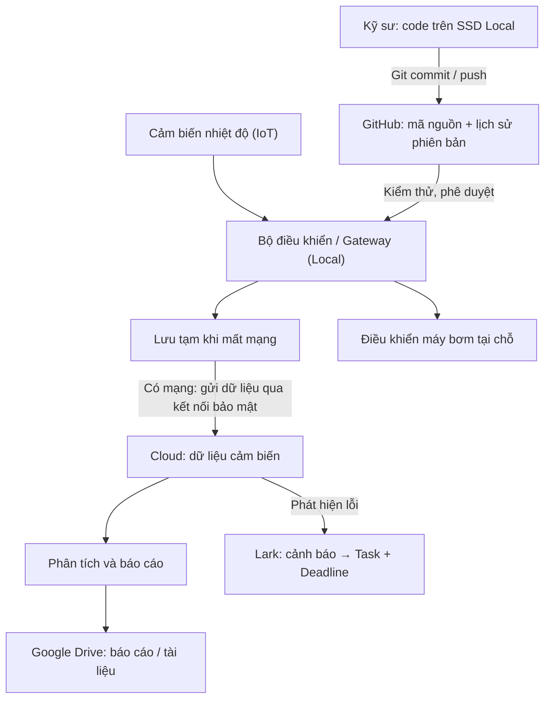

# TRANG TRẠI THÔNG MINH — THIẾT KẾ CLOUD WORKSPACE

## Phần 1. Phân tích và sơ đồ phối hợp

### 1. Mô hình IPO

| Thành phần | Nội dung |
|---|---|
| **Input** | Nhiệt độ từ cảm biến (50 MB/ngày), mã nguồn máy bơm, tài liệu hướng dẫn |
| **Process** | Thiết bị xử lý tại chỗ; đồng bộ dữ liệu, phân tích, tạo báo cáo và cảnh báo trên Cloud |
| **Output** | Máy bơm hoạt động đúng điều kiện, báo cáo nhiệt độ, Task xử lý lỗi có deadline |

### 2. Mô hình DIKW

- **Data:** Cảm biến đo được `35°C`.
- **Information:** Nhiệt độ vượt ngưỡng cài đặt `32°C`.
- **Knowledge:** Nhiệt độ cao kéo dài có thể ảnh hưởng cây trồng.
- **Wisdom:** Người quản lý kiểm tra điều kiện thực tế và quyết định điều chỉnh hệ thống.

*Ngưỡng 32°C chỉ là ví dụ, phải điều chỉnh theo cây trồng.*

### 3. Luồng dữ liệu IoT (Local) → Cloud



**Nguyên tắc:** Máy bơm vẫn phải có chế độ hoạt động an toàn khi mất Internet; không phụ thuộc Cloud để ra lệnh tức thời.

## Phần 2. Đặc tả triển khai (README)

### 4. Cấu trúc lưu trữ

```text
SmartFarm/
├── 01_Code/                 # Link repository GitHub, tài liệu kỹ thuật
├── 02_Sensor_Reports/       # Báo cáo ngày, tuần, tháng
├── 03_Farmer_Guides/        # Hướng dẫn cho nông dân (PDF)
├── 04_Project_Management/   # Kế hoạch, phân công, biên bản
└── 05_Backup_Recovery/      # Hướng dẫn khôi phục, danh mục bản sao lưu
```

- **Local SSD:** Chạy và sửa code, lưu đệm dữ liệu cảm biến khi mất mạng.
- **GitHub (private repository):** Lưu mã nguồn, quản lý thay đổi bằng Git; loại trừ `.env`, `node_modules/` và dữ liệu cảm biến thô khỏi Git.
- **Cloud database/object storage:** Lưu dữ liệu cảm biến theo thời gian và chính sách lưu giữ; không đưa toàn bộ log thô vào thư mục Drive đồng bộ.
- **Google Drive:** Lưu báo cáo, tài liệu hướng dẫn và kế hoạch; dùng Version History khi cần khôi phục tài liệu.
- **Lark:** Trao đổi theo channel và quản lý Task.

### 5. Tránh đầy dung lượng Cloud

- **Dung lượng phát sinh:** `50 MB/ngày × 30 ngày = 1.500 MB ≈ 1,5 GB/tháng` (chưa tính bản sao và dữ liệu phụ).
- **Lưu đệm Local:** Ví dụ giữ 7 ngày dữ liệu gần nhất, sau đó xóa theo chính sách khi đã xác nhận tải lên và sao lưu thành công.
- **Cloud:** Ví dụ giữ dữ liệu thô 30 ngày; dữ liệu cũ nén/chuyển sang kho lưu trữ giá rẻ hoặc xóa theo nhu cầu.
- **Báo cáo:** Tổng hợp theo ngày/tuần/tháng để truy cập nhanh, không cần mở toàn bộ log thô.
- **Files On-Demand (OneDrive) / Stream files (Google Drive):** Chỉ tải file báo cáo về SSD khi cần. **Không làm giảm dung lượng đã chiếm trên Cloud.**

### 6. Bảng phân quyền tối thiểu

| Vai trò | Source code | Dữ liệu cảm biến | Báo cáo | Hướng dẫn |
|---|---|---|---|---|
| Kỹ sư lập trình | **Editor** | Editor theo nhiệm vụ | Viewer | Viewer |
| Người quản lý | Viewer | Viewer | Viewer | Editor |
| Nông dân | Không truy cập | Không truy cập | **Viewer** | **Viewer** |

- Chỉ chia sẻ **Restricted** đến tài khoản được chỉ định; không bật **Anyone with the link** cho dữ liệu nội bộ.
- API keys và mật khẩu phải đặt trong kho quản lý bí mật, **không** đưa vào Git hoặc thư mục chia sẻ.
- Người nghỉ việc: thu hồi quyền trên Drive, GitHub, Lark và các hệ thống dữ liệu liên quan; thay khóa truy cập nếu cần.

### 7. Hybrid Workflow cho kỹ sư

1. **Code trên SSD Local:** Sửa và chạy thử chương trình điều khiển.
2. **Kiểm thử → Git commit → push:** Đẩy code lên repository riêng tư; người có quyền mới được duyệt thay đổi quan trọng.
3. **Cloud Workspace:** Báo cáo/tài liệu được đồng bộ qua Drive; xác nhận trạng thái đồng bộ hoàn tất trước khi tắt máy.
4. **Khôi phục:** Dùng lịch sử Git cho code, Version History/Thùng rác cho tài liệu; duy trì bản sao lưu độc lập.

### 8. Từ lỗi cảm biến thành Task

1. Gateway gửi cảnh báo: `Cảm biến A không phản hồi`.
2. Hệ thống tích hợp chuyển cảnh báo đến channel `#sensor-alerts` trên Lark.
3. Tạo Task: **Kiểm tra cảm biến A**; giao kỹ sư phụ trách, đặt deadline và mức ưu tiên.
4. Kỹ sư xử lý, cập nhật kết quả và đánh dấu **Done**.

*Việc tự tạo Task từ cảnh báo cần cấu hình tích hợp/automation, không tự xảy ra chỉ vì gửi tin nhắn.*

### 9. Access Audit Log hằng tháng

- Kiểm tra **ai có quyền**, ai đã truy cập/chỉnh sửa/chia sẻ dữ liệu quan trọng.
- Phát hiện tài khoản lạ, link công khai, quyền Editor không cần thiết; thu hồi ngay.
- Lưu biên bản kiểm tra và người chịu trách nhiệm.

*Nhật ký chi tiết và thời gian lưu phụ thuộc dịch vụ/gói Google Workspace hoặc nền tảng đang sử dụng.*

## Phần 3. Kiểm thử: Xử lý Data Leak trong 3 bước

1. **Khoanh vùng và thu hồi quyền:** Chuyển file sang **Restricted**, gỡ người lạ và link chia sẻ công khai; khóa tài khoản/thu hồi token bị lộ.
2. **Kiểm tra Activity/Audit Log:** Xác định tài khoản, thời điểm, file bị xem/tải/sửa/xóa và phạm vi ảnh hưởng; lưu bằng chứng.
3. **Khôi phục và phòng ngừa:** Phục hồi dữ liệu từ lịch sử phiên bản/bản sao lưu nếu bị thay đổi; đổi API keys/mật khẩu bị lộ, cấp lại quyền tối thiểu và thông báo người phụ trách.

## Kết luận

**Local** đảm bảo tốc độ và điều khiển máy bơm khi mất mạng; **Cloud** giúp sao lưu, chia sẻ và cộng tác. Kết hợp **Git + Drive + Lark**, phân quyền tối thiểu, giới hạn lưu dữ liệu và kiểm tra Audit Log mỗi tháng giúp dự án vận hành an toàn hơn.
